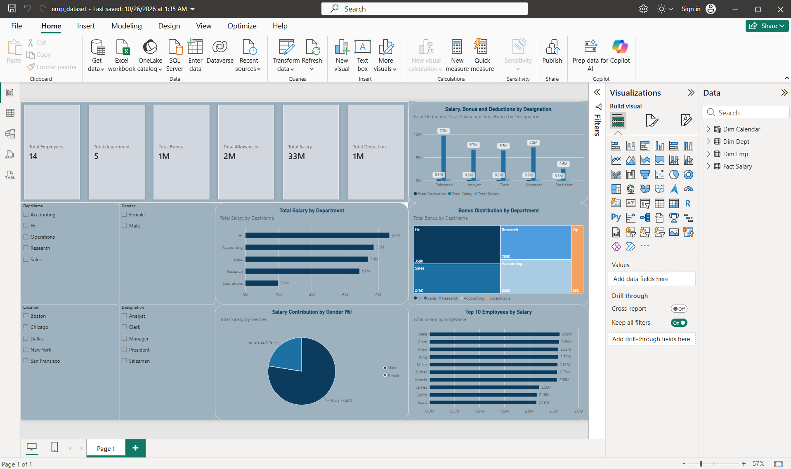

# Employee Salary Analysis Dashboard (Power BI)

An interactive Power BI dashboard that analyzes how salary, bonus and
deductions are distributed across departments, locations, genders and
designations.

## Dataset
Employee data across 5 departments and 5 locations (14 employees),
split into three tables: `Dim Emp`, `Dim Dept` and `Fact Salary`.

## Data Model
Star schema: `Fact Salary` linked to the `Dim Emp` and `Dim Dept`
dimension tables.

## What the dashboard shows
- **KPIs:** total employees, departments, salary, bonus, allowances, deductions
- **Slicers:** department, location, gender, designation
- **Visuals:** total salary by department, bonus distribution (treemap),
  salary contribution by gender, top 10 employees by salary, and
  salary/bonus/deductions by designation

## Key Insights
- HR has the highest total salary (8.7M), followed by Accounting (7.7M) and Sales (7.4M)
- Male employees account for 77.5% of total salary and female employees 22.5%
- Blake is the top earner at 2.62M
- HR also receives the largest share of bonus (359K)

## Tools Used
Power BI Desktop, Power Query (data cleaning), DAX

## How to open
Download `emp_dataset.pbix` and open it in Power BI Desktop.
If the data fails to load, go to **Transform data → Data source settings**
and point each source to the CSV files in this repository
(`dept_dataset.csv` and `employee_dataset (2).csv`).

## Author
Shazin TM · [LinkedIn](https://www.linkedin.com/in/shazin-tm) · [GitHub](https://github.com/Shazin-tm)
